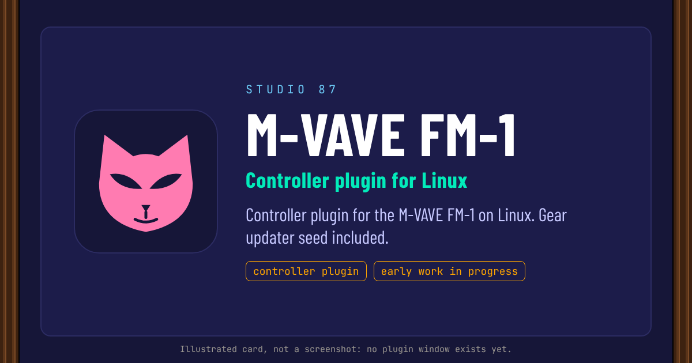
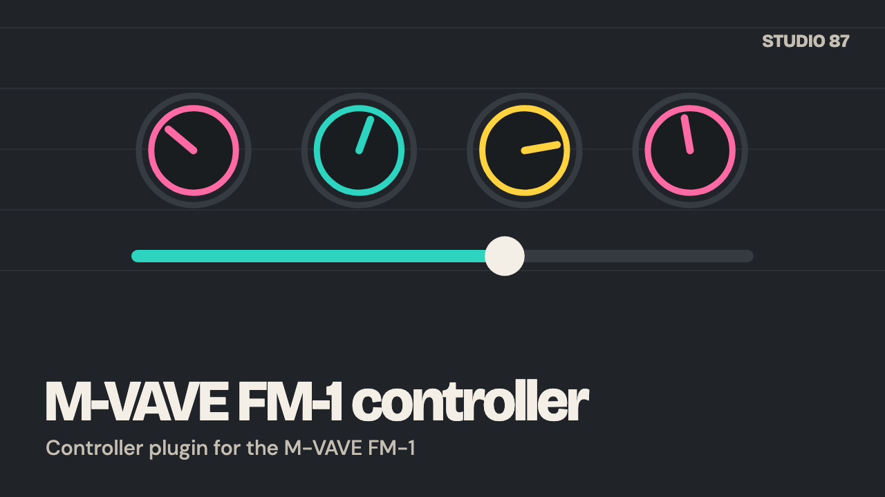

# M-VAVE FM-1 for Linux 🐈

Controller plugin for the M-VAVE FM-1 pocket FM synthesizer on Linux (planned: VST3, Linux). Not built yet; today the repo holds notes and a small command line tool.

## Status
Early work in progress. No FM-1 controller plugin exists yet, nothing is built, and there is no MIDI parameter map: the official MIDI reference has not been read yet (see [MIDI implementation](docs/MIDI-IMPLEMENTATION.md)). See the [web page](docs/index.html).

**Gear updater, first piece:** `tools/gear_updater/` can list MIDI ports (`ports --name FM-1`), listen to one port without sending anything (`monitor`), and check a firmware `.syx` file (framing, size, SHA-256, DX7 bank checksum) with a safety checklist. It does **not** flash anything and has no code path that writes to a device: the FM-1 update protocol is only documented by community projects so far. Run `python3 tools/gear_updater/gear_updater.py dry-run FILE.syx`. Tests: `python3 -m unittest tests/test_gear_updater.py`. A separate `gear-updater` repo does not exist yet; this folder is its seed.

## Download
Nothing to download yet. There are no releases.

## Support

  

Free and open source, made by one person. If it helps your music, a coffee on [Ko-fi](https://ko-fi.com/studio87) keeps it coming.

## Docs
- [Roadmap](ROADMAP.md)
- [MIDI implementation](docs/MIDI-IMPLEMENTATION.md) (sources and status of every row)
- [Device notes](docs/DEVICE-NOTES.md)
- [Firmware notes](docs/FIRMWARE-NOTES.md)
- [Updater design](docs/UPDATER-DESIGN.md) (gear updater, FM-1 first)

## License
AGPL-3.0-or-later, see [LICENSE](LICENSE).

Not affiliated with or endorsed by any hardware maker named here. All trademarks belong to their owners.
